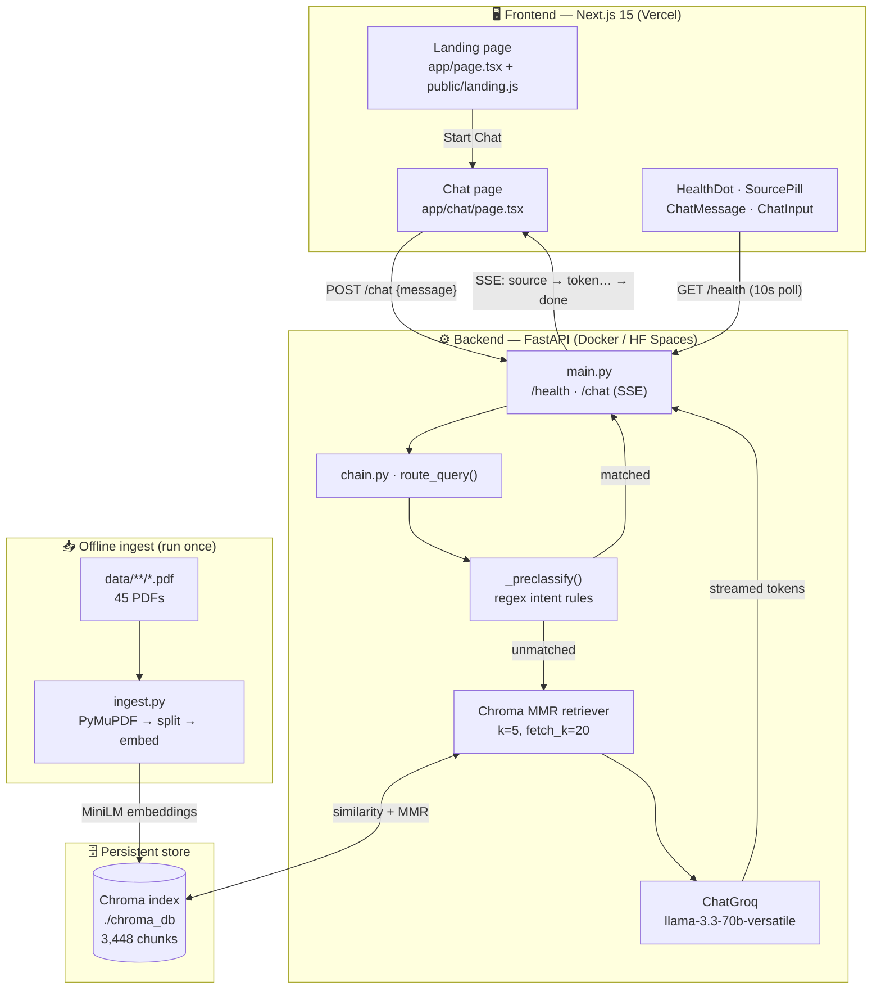
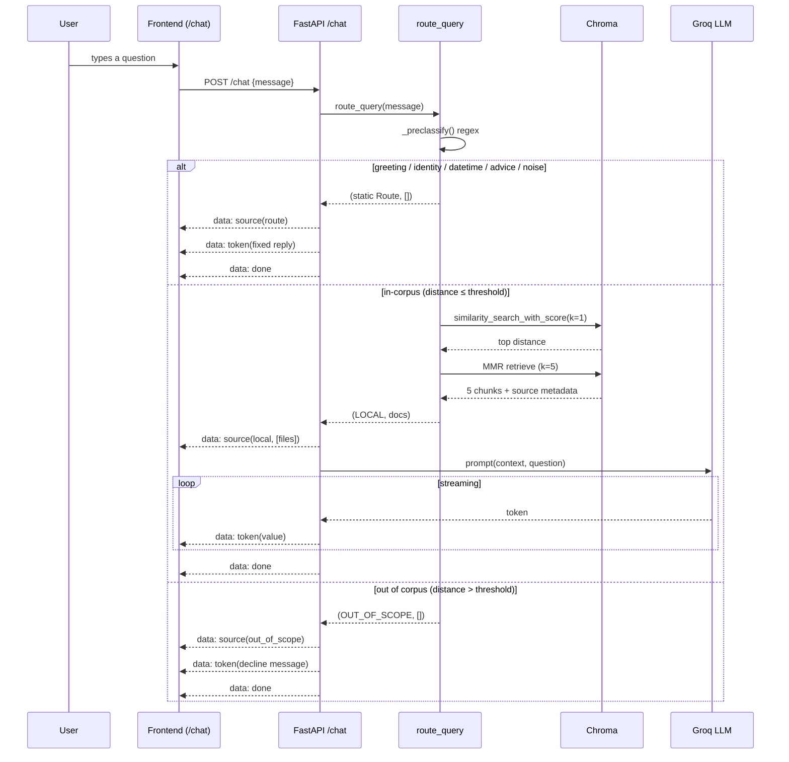
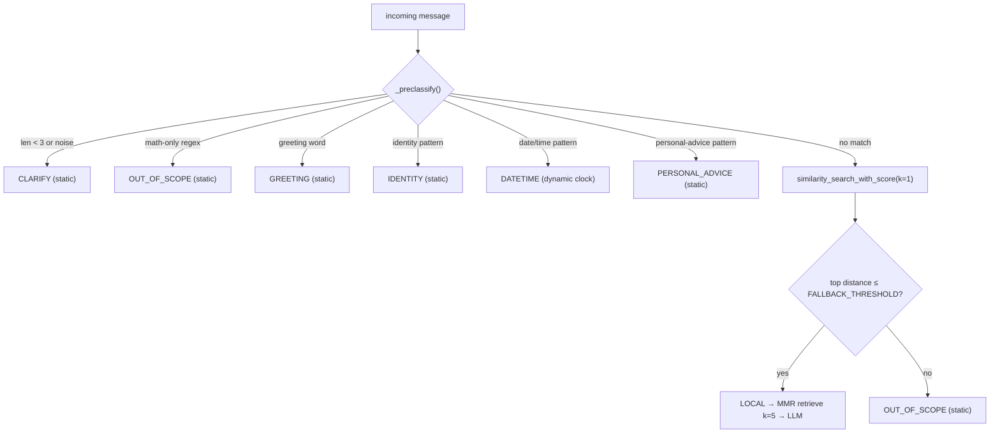

<div align="center">

# 🧬 CancerAtlas

### Ask about cancer. Understand the evidence.

**A retrieval-augmented (RAG) cancer information assistant where every answer traces back to a real medical document — nothing invented, nothing generalized beyond what the sources actually say.**


<br/>


</div>

---

## 📖 What this project does

Large language models are confidently wrong about medicine. Ask a general chatbot a cancer question and it will happily generate an answer with no traceable source — a serious problem when the topic is someone's health.

**CancerAtlas fixes that by refusing to answer from memory.** It only speaks from a curated corpus of medical PDFs (NCI PDQ treatment summaries, WHO reports, IARC GLOBOCAN fact sheets, and ACS Cancer Facts & Figures). When you ask a question:

1. Your question is embedded and matched against a **prebuilt vector index of 3,448 text chunks** drawn from 46 source documents.
2. If a relevant match exists, the five best chunks are handed to an LLM which answers **using only those chunks** — and names which source file each fact came from.
3. If nothing in the corpus is close enough, CancerAtlas **declines** with a fixed message instead of guessing.

### Why it exists / what makes it unique

- **Scoped decline instead of open-ended fallback.** A distance threshold decides whether a question is in-corpus. Out-of-corpus questions never reach the LLM — so the assistant physically cannot answer beyond its sources.
- **Pre-classification before retrieval.** Greetings, "who are you", "what day is it", and personal-medical-advice requests are caught by fast regex rules and answered with fixed replies — no vector search, no LLM call, no token cost.
- **Offline, one-time embeddings.** The corpus is embedded once at ingest and shipped as a Chroma index. There's no per-query embedding cost and no cold-start model download at request time.
- **Streaming, cited answers.** Answers stream token-by-token over Server-Sent Events, and every grounded answer renders the exact source PDFs it drew from.

---

## ✨ Features

| Feature | What it does | How it's implemented | Why it matters |
|---|---|---|---|
| 🎯 **Grounded RAG answers** | Answers cancer questions using only retrieved corpus text | `chain.py` builds `prompt \| ChatGroq \| StrOutputParser`; context is the 5 retrieved chunks, each labeled with its source file | The model can't invent facts — it only has the chunks in front of it |
| 🚦 **Intent router** | Classifies each message into `local`, `greeting`, `identity`, `datetime`, `clarify`, `personal_advice`, or `out_of_scope` | `_preclassify()` regex rules run first; unmatched queries fall through to a vector-distance check in `route_query()` | Cheap, deterministic handling of small talk and unsafe requests without burning an LLM call |
| 🛑 **Scoped decline** | Refuses questions outside the corpus | `similarity_search_with_score(k=1)`; if top distance `> FALLBACK_THRESHOLD` (default `1.0`) → `OUT_OF_SCOPE` static reply | Guarantees no hallucinated medical claims |
| ⚕️ **Medical-advice guardrail** | Blocks "should I…", "do I have…", "diagnose me" style questions | Dedicated `_PERSONAL_ADVICE_PATTERNS` regex list → fixed "consult a physician" reply | Keeps the assistant on the right side of "information, not advice" |
| 📡 **SSE token streaming** | Answers appear word-by-word | FastAPI `StreamingResponse` emits `data:` events (`source` → `token…` → `done`); frontend reads them with a `ReadableStream` reader | Responsive, ChatGPT-style feel |
| 🔖 **Source pills** | Shows which PDFs an answer came from | Backend sends a `sources` array on the `source` event; `SourcePill.tsx` prettifies filenames into `NCI · … / WHO / IARC / ACS` | Every claim is auditable back to a document |
| 💬 **Client-side sessions** | Multiple chats with history, titles, delete | React state persisted to `localStorage` under `cancer-atlas-sessions` | Chat history with zero backend state |
| 🟢 **Live health indicator** | Shows backend online/offline | `HealthDot.tsx` polls `GET /health` every 10s | Instant feedback when the API is down |
| 🎬 **Animated landing journey** | Scroll-driven walkthrough of the RAG pipeline | Raw WebGL shader hero + 2D canvas "journey" + Three.js tubes cursor in `public/landing.js` | Explains the architecture visually before you chat |
| 🌗 **Dark / light theme** | Persistent theme toggle | Inline boot script in `layout.tsx` + `ThemeToggle.tsx`, stored in `localStorage` | No flash-of-wrong-theme on load |
| 🚀 **One-command launcher** | Boots backend + frontend together | `main.py` spawns both, waits for health, opens the browser, pre-warms `/chat` | Single `python main.py` from a cold clone |

---

## 🏗️ Architecture



### Request data flow



---

## 🧰 Tech stack

Every item below appears in the actual source. Nothing here is aspirational.

| Technology | Where | Why it was chosen |
|---|---|---|
| **Next.js 15 (App Router)** + **React 19** | `frontend/` | Server-rendered landing page for fast first paint, client components for the streaming chat |
| **TypeScript 5.6** (`strict`) | `frontend/` | Typed message/session models (`types.ts`) catch shape bugs across the SSE parser |
| **Tailwind CSS v4** (`@tailwindcss/postcss`) | `frontend/app/*.css` | Utility layer imported in `globals.css` alongside hand-written component CSS |
| **Three.js** (`public/tubes1.min.js`) | landing page | Powers the animated "tubes cursor" background, loaded locally (no CDN) |
| **FastAPI 0.139** | `backend/main.py` | Native async + `StreamingResponse` make token-by-token SSE trivial |
| **Uvicorn 0.49** | run target | ASGI server for the async streaming endpoint |
| **LangChain 1.3** (core / community / text-splitters) | `backend/` | Orchestrates loaders, splitter, retriever, prompt, and the streaming LCEL chain |
| **Chroma 1.5** (`langchain-chroma`) | `chain.py`, `ingest.py` | Persistent on-disk vector store — build the index once, ship it in the image |
| **HuggingFace `all-MiniLM-L6-v2`** | embeddings | 384-dim, CPU-only, ~90 MB — runs offline with no per-query API cost |
| **Groq `llama-3.3-70b-versatile`** | `chain.py` | Fast hosted inference with real token streaming (`streaming=True`, temp `0.2`) |
| **PyMuPDF 1.28** (`PyMuPDFLoader`) | `ingest.py` | Reliable, fast text extraction from the medical PDFs |
| **Sentence-Transformers 5.6** | embeddings backend | Runs the MiniLM model that produces the vectors |

---

## 📂 Folder structure

```
CancerAtlas/
├── main.py                        # 🚀 Root launcher — boots backend + frontend, opens browser, pre-warms /chat
├── start.bat                      # Windows double-click wrapper around main.py
├── README.md                      # You are here
│
├── backend/                       # ⚙️ FastAPI RAG service
│   ├── main.py                    # FastAPI app: /health + /chat (SSE), CORS, lifespan builds the chain
│   ├── chain.py                   # Core RAG logic: routing, retriever, LLM, prompt, static replies
│   ├── ingest.py                  # Offline pipeline: PDFs → chunks → embeddings → Chroma
│   ├── requirements.txt           # Pinned Python dependencies
│   ├── Dockerfile                 # python:3.11-slim image (HF Spaces, port 7860)
│   ├── .env.example               # GROQ_API_KEY, FALLBACK_THRESHOLD, ALLOWED_ORIGINS, PORT
│   ├── README.md                  # Backend-specific docs
│   ├── data/                      # 📄 Source corpus (gitignored) — 45 PDFs
│   │   ├── broad/                 #   15 PDFs — ACS Cancer Facts & Figures, patient guides
│   │   ├── stats/                 #   20 PDFs — IARC GLOBOCAN per-cancer fact sheets
│   │   └── types/                 #   10 PDFs — NCI PDQ per-cancer treatment summaries
│   ├── chroma_db/                 # 🗄️ Prebuilt vector index (committed) — 3,448 chunks
│   └── scripts/                   # 🔧 Dev / QA utilities
│       ├── verify_pdfs.py         #   Loads every PDF, counts pages/chars, flags suspect files
│       ├── sanity_check.py        #   Runs 3 queries, prints top-3 retrieved chunks
│       ├── test_chain.py          #   Runs 20 queries across all routes end-to-end
│       └── test_context_ignorance.py  # Sends off-topic queries with empty context, checks for hallucination
│
├── frontend/                      # 🖥️ Next.js 15 app
│   ├── app/
│   │   ├── layout.tsx             # Root layout, Inter font, no-flash theme boot script
│   │   ├── page.tsx               # Landing page (hero, scroll journey, finale)
│   │   ├── globals.css            # Theme tokens (light/dark) + Tailwind import
│   │   ├── landing.css            # Landing page styles
│   │   ├── chat/
│   │   │   ├── page.tsx           # Chat controller: sessions, SSE fetch/parse loop
│   │   │   ├── types.ts           # Message / Session / MessageVariant types
│   │   │   └── chat.css           # Chat UI styles
│   │   └── components/
│   │       ├── ChatSidebar.tsx    # Session list, new/delete chat
│   │       ├── ChatMessage.tsx    # User/bot bubbles, variant styling, source pills
│   │       ├── ChatInput.tsx      # Auto-resizing textarea, Enter-to-send
│   │       ├── HealthDot.tsx      # Polls /health every 10s
│   │       ├── SourcePill.tsx     # Prettifies PDF filenames → NCI/WHO/IARC/ACS
│   │       └── ThemeToggle.tsx    # Dark/light toggle, persists to localStorage
│   ├── public/
│   │   ├── landing.js             # WebGL shader + canvas journey + finale + tubes cursor
│   │   └── tubes1.min.js          # Bundled Three.js (tubes cursor library)
│   ├── package.json               # next / react / react-dom + TS + Tailwind toolchain
│   ├── next.config.mjs            # reactStrictMode
│   ├── tailwind.config.ts         # Tailwind content globs
│   ├── tsconfig.json              # strict TS config, @/* path alias
│   └── .env.example               # NEXT_PUBLIC_API_URL
│
└── design-references/             # Original HTML prototypes + planning docs (gitignored)
```

---

## ⚙️ Installation

### Prerequisites

- **Python 3.11+**
- **Node.js 18+** (the launcher checks for `node` on your `PATH`)
- A **Groq API key** → https://console.groq.com

### 1. Backend environment variables (`backend/.env`)

Copy the example and fill in your key:

```bash
cd backend
cp .env.example .env
```

| Variable | Default | Purpose |
|---|---|---|
| `GROQ_API_KEY` | — | **Required.** Groq key for LLM inference |
| `FALLBACK_THRESHOLD` | `1.0` | Max Chroma distance for a question to count as in-corpus |
| `ALLOWED_ORIGINS` | `*` | Comma-separated CORS origins |
| `PORT` | `8000` | Port the backend binds to |

### 2. Frontend environment variable (`frontend/.env.local`)

```bash
cd frontend
cp .env.example .env.local
```

| Variable | Default | Purpose |
|---|---|---|
| `NEXT_PUBLIC_API_URL` | `http://localhost:8000` | Base URL of the backend |

### 3. Install Python dependencies

```bash
pip install -r backend/requirements.txt
```

### 4. Run everything — one command

From the **project root**:

```bash
python main.py
```

This installs frontend deps on first run, starts the backend on `:8000` and the frontend on `:3000`, waits for both to come up, opens `http://localhost:3000`, and pre-warms the `/chat` route. Press `Ctrl+C` to stop both. On Windows you can also just double-click **`start.bat`**.

> The first run downloads the MiniLM embedding model (~90 MB) once and caches it. On later runs the launcher loads it offline from disk.

### Running the two services manually (optional)

```bash
# Backend
cd backend && python main.py

# Frontend (separate terminal)
cd frontend && npm install && npm run dev
```

### Rebuilding the vector index

The `chroma_db/` index is committed, so you don't need this to run the app. To rebuild it from the PDFs in `backend/data/`:

```bash
cd backend
python ingest.py            # skips if chroma_db/ already exists
python ingest.py --rebuild  # deletes and rebuilds from scratch
```

---

## 🕹️ Usage

1. Open **`http://localhost:3000`** — the landing page walks through the pipeline.
2. Click **Start Chat** to reach `/chat`.
3. Ask a question, or click a suggestion chip.

**Questions it answers (in-corpus):**

```text
What are common symptoms of lung cancer?
How is stage III colon cancer treated?
What are common side effects of chemotherapy?
What is the global incidence of prostate cancer?
```

**Questions it deliberately declines (out-of-corpus):**

```text
What is the capital of France?    → out_of_scope reply
2 + 2                             → out_of_scope reply
Should I take chemo?              → personal_advice reply (see a physician)
```

### Talking to the API directly

```bash
curl -N -X POST http://localhost:8000/chat \
  -H "Content-Type: application/json" \
  -d '{"message": "What is metastasis?"}'
```

The response is an SSE stream:

```text
data: {"type": "source", "value": "local", "sources": ["takingtime.pdf"]}

data: {"type": "token", "value": "Metastasis"}

data: {"type": "token", "value": " is"}

data: {"type": "done"}
```

Health check:

```bash
curl http://localhost:8000/health
# {"status": "ok"}
```

---

## 🔬 How it works internally

### 1. Ingestion pipeline (`ingest.py`, run once)

```
data/**/*.pdf  →  PyMuPDFLoader  →  RecursiveCharacterTextSplitter  →  MiniLM embeddings  →  Chroma (./chroma_db)
                  (1 loader/PDF)     (1000 chars, 150 overlap)         (384-dim, CPU)
```

- Every PDF is loaded page-by-page. Each page gets two metadata fields: **`source_file`** (the filename) and **`doc_category`** (its parent folder — `broad`, `stats`, or `types`). `None` metadata values are replaced with `""` because Chroma rejects nulls.
- Empty pages are dropped, then text is split with `RecursiveCharacterTextSplitter(chunk_size=1000, chunk_overlap=150, separators=["\n\n", "\n", ". ", " ", ""])` — the overlap keeps clinical ideas from being cut mid-sentence.
- Chunks are embedded with `sentence-transformers/all-MiniLM-L6-v2` and written to a persistent Chroma store. The committed index holds **3,448 chunks across 46 source documents**.

### 2. Routing (`chain.py · route_query`)

Every message is classified before any expensive work:



Only the **`LOCAL`** route ever calls the LLM. Every other route returns a pre-written string (or, for `datetime`, the server clock) — so small talk and unsafe questions cost nothing and can't hallucinate.

### 3. Retrieval + generation

- **Retriever:** Chroma in **MMR** (Maximal Marginal Relevance) mode — `k=5`, `fetch_k=20`. It pulls 20 candidates and picks 5 that are relevant *and* diverse, avoiding five near-duplicate chunks.
- **Context assembly:** `format_context()` prefixes each chunk with `[source_file]` so the model can cite where facts came from.
- **LLM:** `ChatGroq(model="llama-3.3-70b-versatile", temperature=0.2, streaming=True)`. The system prompt hard-constrains it: answer **only** from the provided context, never diagnose, never recommend individual treatment, and name the source file.
- **Chain:** `prompt | llm | StrOutputParser()` — a LangChain LCEL runnable streamed via `.astream()` in the API and `.stream()` in the CLI `run()` helper.

### 4. Streaming transport (`main.py · /chat`)

The endpoint returns a `StreamingResponse` of `text/event-stream`. Order is always: one **`source`** event (route + contributing files) → zero-or-more **`token`** events → a **`done`** event. Any mid-stream exception emits an **`error`** event before `done`. Empty/whitespace messages are rejected with **HTTP 422** before streaming starts.

### 5. Frontend consumption (`app/chat/page.tsx`)

The chat page `fetch()`es `/chat`, reads the body with a `ReadableStream` reader, splits the buffer on `\n\n`, and parses each `data:` line. `token` events append to the active assistant message; the `source` event's `sources` array becomes source pills; `clarify` / `personal_advice` / `out_of_scope` / `error` set a message **variant** that changes the bubble's styling. Sessions live entirely in `localStorage` — the backend is stateless.

---

## 📸 Screenshots

> Replace the placeholders below with your own captures.

| Landing — hero & pipeline journey | Chat — grounded answer with source pills |
|---|---|
| `<!--  -->` | `<!--  -->` |

| Out-of-scope decline | Dark / light theme |
|---|---|
| `<!--  -->` | `<!--  -->` |

---

## 🗺️ Roadmap

These are honest gaps and next steps based on the current code — not promises.

| Status | Improvement | Notes |
|---|---|---|
| 🔜 | Multi-turn conversation memory | Backend is currently stateless; each `/chat` is independent |
| 🔜 | Markdown rendering in answers | `ChatMessage` renders content as plain text today |
| 🔜 | Tighten production CORS | `ALLOWED_ORIGINS` defaults to `*` |
| 🔜 | Inline / clickable citations | Source pills exist; per-sentence anchoring does not |
| 🔜 | Automated test suite + CI | `scripts/` has manual checks but no test runner or pipeline |
| 🔜 | Threshold & `k` tuning surface | `FALLBACK_THRESHOLD` and retriever `k` are env/code constants |
| 🔮 | Corpus expansion & re-ingest tooling | Add PDFs to `data/` and rebuild; no incremental update yet |
| 🔮 | Deployed live demo links | Backend → HF Spaces (Docker), Frontend → Vercel |

---

## 👤 Author

**Mian Daniyal Hassan**

[](https://daniyal-s-new-portfolio.vercel.app)
[](https://github.com/MianDaniyalHassan)
[](https://www.linkedin.com/in/mian-daniyal-hassan-849971293)

---

## ⚖️ License & disclaimer

No `LICENSE` file is present in this repository yet — add one to declare usage terms.

> **CancerAtlas provides educational, evidence-grounded information. It is not a substitute for professional medical advice, diagnosis, or treatment. Always talk to a qualified physician about your own health.**

<div align="center">

**Built with 🔬 by Mian Daniyal Hassan** · Powered by <span style="color:#00F7FF">LangChain</span> · <span style="color:#00F7FF">Chroma</span> · <span style="color:#00F7FF">Groq</span>

</div>
